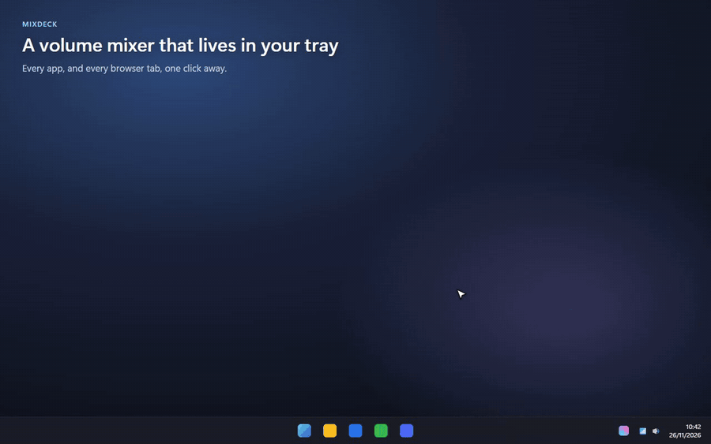
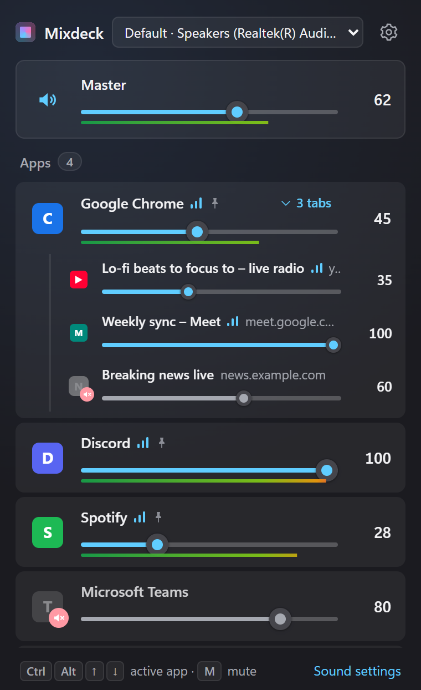
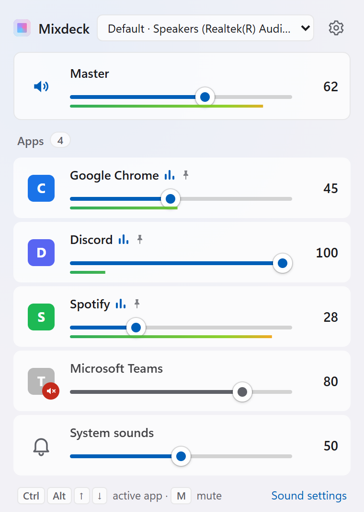
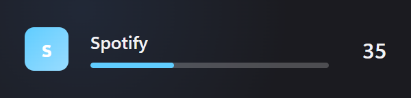

# Mixdeck

[](https://github.com/wishnuat/mixdeck/actions/workflows/ci.yml)

**A tray mixer for Windows 11: volume per app *and per browser tab*, with live level meters, remembered volumes,
and hotkeys for the app you're using.**



[Watch the tutorial in full quality (MP4, 40 s)](docs/mixdeck-demo.mp4). It was recorded headlessly from the real
UI with a mocked backend; see `demo-video/`.

<p>
  
  
</p>

Windows already has a per-app volume mixer, but it's three clicks deep in Settings, it forgets your levels when an
app restarts, and it can't tell one browser tab from another, because every tab plays through the same browser
process. Mixdeck lives in the tray and fixes all three. With its browser extension, the Chrome row expands into its
tabs, so the Meet call stays loud while YouTube plays quietly.

## Features

- **Flyout from the tray**, anchored above the clock like the built-in flyouts, with a Mica backdrop, rounded
  corners, and light and dark themes. It closes when you click elsewhere
- **Volume and mute for every app**, with real icons and product names read from each executable. Apps that open
  many streams (Chrome, Discord) still show as **one row**
- **Live peak meters** for every app and the master output, so you can see *who* is making that sound. Meters run
  only while the flyout is open, so there's no idle CPU cost
- **Remembered volumes.** When an app restarts, or opens a new audio stream (the reason Chrome keeps coming back at
  100 %), its last volume and mute state are restored automatically. You can manage or forget them in Settings
- **Hotkeys for the app in front**, from any app: `Ctrl+Alt+↑/↓` changes its volume by 5 % and `Ctrl+Alt+M`
  mutes it. A small on-screen display confirms the change

  

- **Every browser tab gets its own volume and mute** (Chrome, Edge, Brave), shown under the browser's row:
  - the **site's own volume control keeps working**. Mixdeck multiplies it rather than overriding it, and the
    site still reads back its own value
  - covers `<audio>`/`<video>` (including `new Audio()` objects that are never added to the page) and **Web Audio**
    (games, music apps), in every frame
  - **remembered per site**: set youtube.com to 40 % once and every YouTube tab starts there
  - the extension popup works **on its own** too, even when the Mixdeck app isn't running
- **Output devices.** Pick any active output, or follow the Windows default (switching headphones is picked up
  automatically)
- Mouse wheel over a row changes it by ±2 %, double-clicking the percentage resets it to 100 %, and `Esc` closes the
  flyout
- Start with Windows, single instance, and about a 3 MB installer

## Install

1. Run `Mixdeck_x.y.z_x64-setup.exe` from [Releases](https://github.com/wishnuat/mixdeck/releases). Mixdeck appears
   in the tray
2. To control tabs, open **Settings → Browser tabs → Show extension folder**. Then open `chrome://extensions` (or
   `edge://extensions`), turn on **Developer mode**, click **Load unpacked** and pick that folder. Mixdeck
   registers itself as the extension's native-messaging host automatically, per user, with no admin rights

## How it works

```
┌──────────── Rust (Tauri) ─────────────────────────────────────────┐
│ audio thread: one COM MTA thread owns every WASAPI object          │
│   IMMDeviceEnumerator → IAudioSessionManager2 → sessions           │
│   ISimpleAudioVolume · IAudioMeterInformation · IAudioEndpointVolume│
│   ▲ Cmd channel                  │ "mixer" on change (1 Hz scan)   │
│   │                              │ "levels" 30 Hz while visible    │
│ tray · global shortcuts · OSD window · mixdeck.json                │
└──────────────┬───────────────────┴─────────────────────────────────┘
               │ invoke / listen
      React flyout (index.html)   ·   OSD (index.html#osd)
```

- **One thread owns COM.** WASAPI interfaces are `!Send`, so a dedicated thread holds them and the UI, tray and
  hotkeys send it commands over a channel. Bursts of slider events are coalesced before they're applied
- **Sessions are grouped by executable.** Every scan also checks for *new* session instance IDs, which receive the
  remembered volume, or the volume of an existing sibling session from the same app
- **Meters don't re-render React.** Peaks arrive at 30 Hz; a `requestAnimationFrame` loop writes `clip-path`
  directly to the DOM with fast attack, smooth release and a square-root curve for perceived loudness
- **The slider is optimistic.** For 700 ms after you touch a control, server snapshots for that control are ignored,
  so the thumb never jumps back while you drag
### Browser tabs

```
extension (MV3)                                   Mixdeck app
 background: tab list, native mute,                tab hub on 127.0.0.1 (random port + token in
   per-site memory                                 %APPDATA%\id.wishnu.mixdeck\bridge.json)
 page-gain.js (MAIN world): volume ×gain,               ▲
   Web Audio via a per-context GainNode                 │ newline-delimited JSON
        │ chrome.runtime.connectNative                   │
        └──stdio (4-byte length + JSON)──▶ mixdeck.exe chrome-extension://…/  (bridge mode)
```

- **One executable.** When Chrome starts `mixdeck.exe` as a native host it passes the extension origin as
  `argv[1]`. `main()` sees that and runs a small relay instead of the UI, before the single-instance check
- **Which browser?** The bridge walks up its parent processes. On Windows, Chrome starts native hosts through
  `cmd.exe /c`, so the shell is skipped to find `chrome.exe`/`msedge.exe`. The end-to-end test caught this; tabs
  had been showing up under "Windows Command Processor"
- **Gain without breaking sites.** `HTMLMediaElement.prototype.volume` is redefined: the setter stores the site's
  value and applies `site × gain`, and the getter returns the site's value. `BaseAudioContext.prototype.destination`
  returns a per-context `GainNode` wired to the real destination
- **Security.** The host manifest only allows this extension's fixed ID (pinned with a public `key` in
  `manifest.json`). The hub listens on loopback only and drops any connection that doesn't present the
  per-session token

- **Product names and icons** come from the executable's version resource (`FileDescription`) and
  `PrivateExtractIconsW`, converted from BGRA to PNG data URLs

## Development

Requirements: Windows 10/11, Rust (MSVC), Node 18+.

```bash
npm install
npm run tauri dev            # run the app
npm run tauri build          # installer → src-tauri/target/release/bundle/nsis/

cd src-tauri
cargo test                   # unit tests, a live audio-stack test, and an E2E test of the real exe in bridge mode
cargo run --example snapshot # print devices, apps and peak levels as the engine sees them
```

Extension tests (Playwright, headless):

```bash
python extension/tests/test_page_gain.py           # 11 behaviour checks of page-gain.js in real Chrome
# full pipeline: Chromium + unpacked extension + native messaging + a running Mixdeck (MIXDECK_TRACE=1, stderr → log)
python extension/tests/test_e2e.py <mixdeck-stderr-log>
```

`preview/` renders the real UI in a browser with the Tauri APIs mocked, for UI review and the screenshots above:

```bash
npx vite --config preview/vite.preview.config.ts
python preview/shoot.py
```

## Roadmap

See [docs/PLAN.md](docs/PLAN.md) for the full product plan.

- [x] Phase 1: per-app mixer, meters, memory, hotkeys, OSD, devices
- [x] Phase 2: browser tabs via a Chrome/Edge/Brave extension and native messaging
- [ ] Publish the extension to the Chrome Web Store / Edge Add-ons (no Developer mode needed)
- [ ] Tab boost above 100 % (`chrome.tabCapture`) and per-tab level meters
- [ ] Firefox extension
- [ ] Per-app output device routing
- [ ] Profiles ("Meeting", "Gaming") switchable from the tray

## License

MIT
